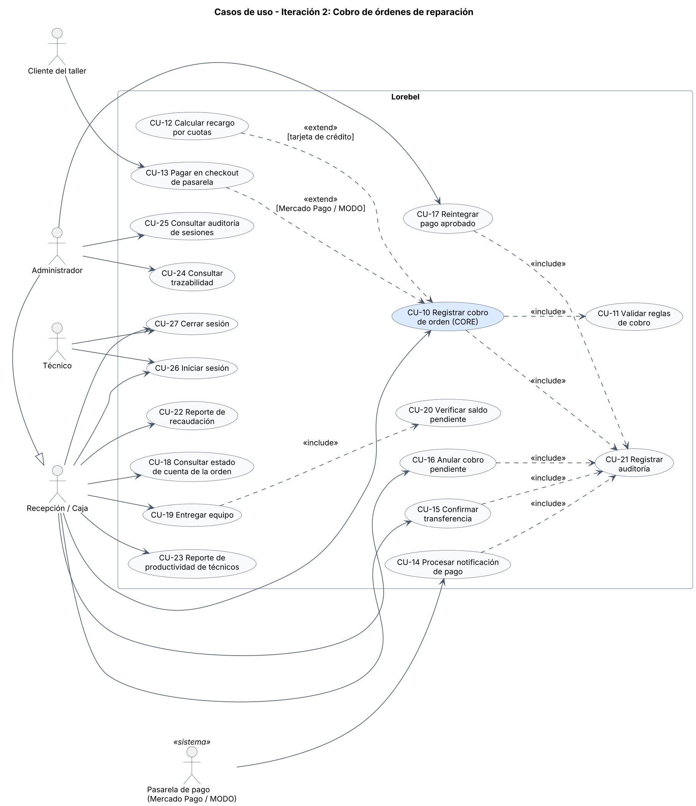
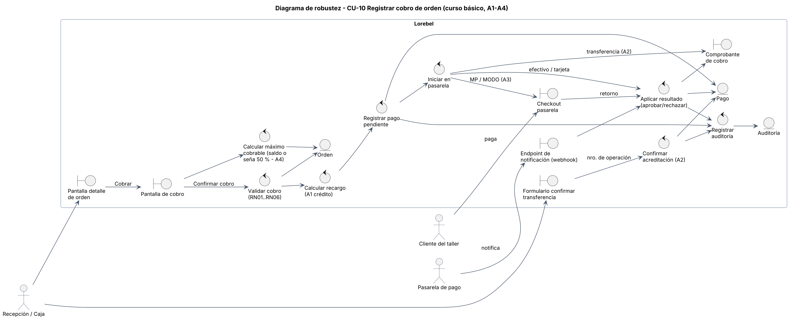
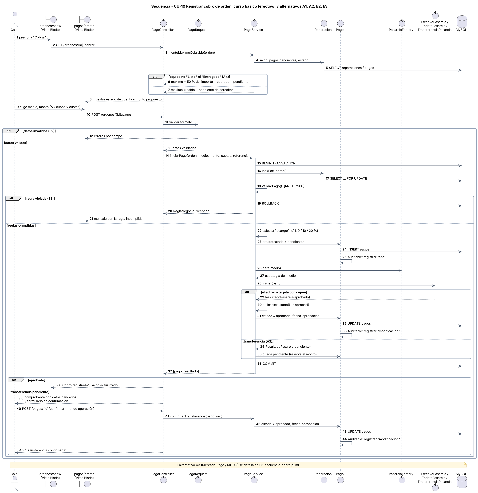
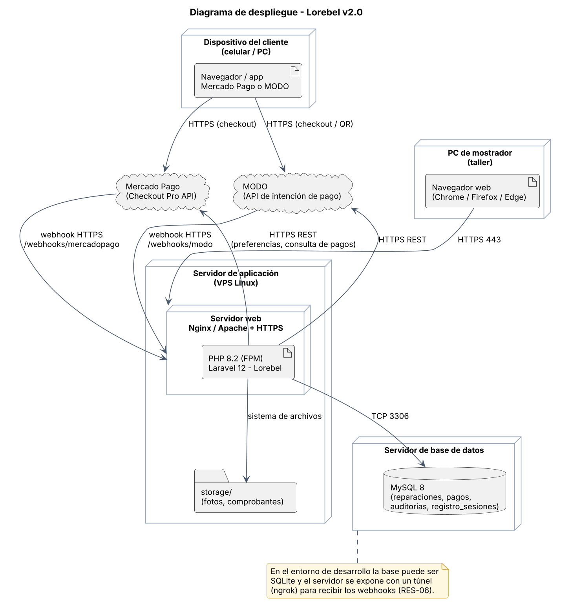

# Propósito del anexo

Este anexo completa el documento principal `LOREBEL.pdf` (versión 1) con los artefactos que la checklist del TP de la cátedra exige y que no estaban completos en la versión anterior. Cada sección indica a qué punto del documento principal complementa o reemplaza. Los diagramas citados están en la carpeta `diagramas/` (fuente `.puml` y versión `.png`).

| Sección del anexo | Criterio de la checklist que cubre | Complementa a |
|---|---|---|
| A. Requerimientos funcionales | Funcionales identificados y numerados | 12.1 |
| B. Requerimientos no funcionales | No funcionales clasificados | 12.1 |
| C. Glosario | Alcance, actores y glosario acordados | 12.0 |
| D. Complemento de CU-10 | Especificación con disparador | 12.3.2 |
| E. Diagramas de casos de uso y robustez corregidos | include/extend con sentido; reglas de comunicación de robustez | 12.3.1 y 12.4.1 |
| F. Secuencia del curso básico | Un diagrama de secuencia con curso básico y alternativos | 12.5.1 |
| G. Vistas de arquitectura y despliegue | Vistas separadas; despliegue, nodos y tecnologías | 14.4 |
| H. Patrón Strategy (estándar UNR) | Patrones: problema, participantes, estructura y comportamiento | 12.5.2 y 14.4 |
| I. Matriz de trazabilidad | Cada requisito se vincula con CU; trazabilidad hasta TEST | — (nuevo) |
| J. Cobertura y registro de ejecución | Cobertura medida; pruebas re-ejecutables | 14.5 |
| K. Pendientes con interesados | Prototipo revisado con usuarios; hito RRR | 6.4.4 y 9.2 |

# A. Requerimientos funcionales

Los requerimientos se expresan como capacidades observables, sin decisiones de implementación. Los RF-01 a RF-09 corresponden a la iteración 1 (Seminario de Aplicación Profesional) y se listan para dar continuidad a la numeración; el alcance de diseño ICONIX de este trabajo son los RF-10 a RF-20 (iteración 2).

| ID | Requerimiento funcional | Iteración | Prioridad | Criterio de aceptación |
|---|---|---|---|---|
| RF-01 | Registrar, modificar, consultar y dar de baja clientes del taller. | 1 | Alta | Un cliente dado de baja no aparece en la búsqueda de órdenes pero conserva su historial. |
| RF-02 | Registrar, modificar, consultar y dar de baja técnicos, con estado activo/inactivo. | 1 | Alta | Solo los técnicos activos pueden asignarse a una orden. |
| RF-03 | Registrar órdenes de reparación con los datos del equipo y el problema reportado. | 1 | Alta | La orden queda en estado “Ingresado” con fecha de ingreso. |
| RF-04 | Registrar diagnóstico, trabajo realizado y cambios de estado de la orden. | 1 | Alta | El estado sigue el ciclo Ingresado → En reparación → Listo → Entregado (o Cancelado). |
| RF-05 | Registrar el presupuesto y su aprobación por parte del cliente. | 1 | Alta | La fecha de aprobación queda registrada al aprobarse. |
| RF-06 | Adjuntar fotos del equipo a la orden. | 1 | Media | Las fotos se visualizan en el detalle y pueden eliminarse. |
| RF-07 | Emitir el comprobante imprimible de la orden. | 1 | Media | Se genera un PDF con los datos de la orden y el cliente. |
| RF-08 | Buscar y filtrar órdenes por estado, técnico y texto libre. | 1 | Media | El listado muestra solo las órdenes que cumplen todos los filtros. |
| RF-09 | Buscar clientes con autocompletado al crear una orden. | 1 | Baja | Al escribir tres letras se sugieren clientes coincidentes. |
| **RF-10** | **Registrar el cobro total o parcial de una orden con seis medios de pago (CORE).** | 2 | Alta | Ver criterios de aceptación del punto 12.1. |
| RF-11 | Confirmar manualmente una transferencia con número de operación y comprobante. | 2 | Alta | El pago pasa de pendiente a aprobado y el saldo disminuye. |
| RF-12 | Anular un cobro pendiente indicando el motivo. | 2 | Media | El monto reservado vuelve a estar disponible para cobrar. |
| RF-13 | Reintegrar un cobro aprobado indicando el motivo (solo administrador). | 2 | Media | El saldo de la orden aumenta en el monto reintegrado. |
| RF-14 | Consultar el estado de cuenta de cada orden y el listado general de cobros. | 2 | Alta | Se muestran importe, cobrado, pendiente de acreditar y saldo. |
| RF-15 | Impedir la entrega de un equipo con saldo pendiente. | 2 | Alta | Pasar a “Entregado” con saldo mayor a cero es rechazado (RN09). |
| RF-16 | Registrar la trazabilidad de altas, modificaciones y bajas de órdenes, pagos y clientes. | 2 | Alta | Cada cambio guarda usuario, fecha, IP, valor anterior y valor nuevo. |
| RF-17 | Consultar la trazabilidad general y la de una orden. | 2 | Media | Se muestra el estado original y la línea de tiempo de cambios. |
| RF-18 | Iniciar y cerrar sesión con tres roles (administrador, recepción/caja, técnico). | 2 | Alta | Cada rol accede solo a las funciones habilitadas. |
| RF-19 | Registrar y consultar los inicios, cierres e intentos fallidos de sesión. | 2 | Media | El reporte filtra por evento, usuario y fechas. |
| RF-20 | Emitir el reporte de recaudación por medio de pago. | 2 | Media | Muestra totales, ticket promedio, porcentaje digital y gráficos por período. |
| RF-21 | Emitir el reporte de productividad de técnicos. | 2 | Media | Muestra órdenes asignadas, terminadas, efectividad y días promedio por técnico. |

# B. Requerimientos no funcionales

Se mantienen RNF-01 a RNF-06 del punto 12.1 y se agregan los atributos de calidad que faltaban. Cada uno tiene un criterio comprobable.

| ID | Categoría | Requerimiento | Criterio de aceptación |
|---|---|---|---|
| RNF-01 | Seguridad | Acceso autenticado; cobros solo para administrador y recepción; reintegros y auditoría solo administrador. | Un técnico recibe 403 al cobrar o ver auditoría (prueba automatizada). |
| RNF-02 | Integridad | Dos cobros simultáneos sobre la misma orden no superan el saldo. | Registro en transacción con bloqueo de fila. |
| RNF-03 | Seguridad de integración | Las notificaciones de pago se verifican contra la API y la firma. | Webhook con firma inválida responde 401 (prueba automatizada). |
| RNF-04 | Datos sensibles | No se almacenan datos de tarjetas. | La tabla `pagos` solo guarda cupón o identificador externo. |
| RNF-05 | Usabilidad | Cobro en una sola pantalla con cálculo inmediato. | Un cobro en efectivo se completa en menos de 30 segundos. |
| RNF-06 | Trazabilidad | Toda operación sobre órdenes y pagos queda auditada. | El reporte muestra estado original y todos los cambios. |
| RNF-07 | Desempeño | Las pantallas operativas responden rápido con el volumen de un taller pequeño. | Con 5.000 órdenes y 20.000 pagos, el detalle de orden y la pantalla de cobro responden en menos de 2 s; los reportes de un mes, en menos de 5 s. |
| RNF-08 | Desempeño | El webhook responde dentro del plazo de la pasarela. | La respuesta HTTP 200 se envía en menos de 5 s para evitar reintentos. |
| RNF-09 | Portabilidad | El sistema funciona en los navegadores y servidores habituales. | Opera en Chrome, Firefox y Edge actuales; servidor Linux o Windows con PHP 8.2+ y MySQL 8 (pruebas en SQLite). |
| RNF-10 | Disponibilidad | El sistema está disponible durante el horario del taller. | Disponibilidad mensual ≥ 99 % entre 8 y 20 h; respaldo diario de la base con retención de 30 días. |
| RNF-11 | Disponibilidad | Una falla de la pasarela no detiene la operación. | Si la API de Mercado Pago o MODO no responde, el cobro puede hacerse con otro medio (E4 de CU-10). |
| RNF-12 | Mantenibilidad | Agregar un medio de pago no modifica las reglas de cobro. | Un medio nuevo requiere una clase que implemente `PasarelaPago` y una línea en `PasarelaFactory` (patrón Strategy, sección H). |
| RNF-13 | Legal | Tratamiento de datos personales según la Ley 25.326. | Los datos de clientes solo son visibles para usuarios autenticados y los cambios quedan auditados. |

# C. Glosario

| Término | Definición |
|---|---|
| Orden de reparación | Registro de un equipo ingresado al taller para su diagnóstico y reparación. Concepto central del dominio. |
| Cliente del taller | Persona que deja el equipo y paga la reparación. |
| Técnico | Persona que diagnostica y repara el equipo asignado a una orden. |
| Recepción / Caja | Rol que atiende el mostrador, registra órdenes y cobra. |
| Administrador | Rol con acceso total: además de lo de Caja, reintegra pagos y consulta la auditoría. |
| Presupuesto | Importe estimado de la reparación que el cliente debe aprobar antes de cobrar. |
| Importe de la orden | Costo final si fue calculado; si no, el presupuesto aprobado (SUP-06). |
| Pago / Cobro | Registro de dinero recibido para una orden con un medio de pago. Se usan como sinónimos solo en la interfaz; en el modelo el concepto es **Pago**. |
| Medio de pago | Forma de cobro: efectivo, transferencia, Mercado Pago, MODO, tarjeta de débito o tarjeta de crédito. |
| Pasarela de pago | Sistema externo que procesa el pago digital y notifica el resultado (Mercado Pago, MODO). |
| Seña | Cobro parcial anticipado mientras el equipo no está “Listo”; máximo 50 % del importe (RN05). |
| Saldo | Importe de la orden menos los pagos aprobados (atributo derivado). |
| Pendiente de acreditar | Suma de los pagos en estado pendiente; reduce el máximo cobrable (RN04). |
| Máximo cobrable | Saldo menos pendiente de acreditar, o el tope de seña si corresponde. |
| Recargo por cuotas | Interés financiero de la tarjeta de crédito (0 %, 10 %, 20 %); no se imputa al saldo (RN06). |
| Cupón | Número de autorización que emite la terminal (posnet) al cobrar con tarjeta. |
| Checkout | Página de la pasarela donde el cliente realiza el pago digital. |
| Webhook / notificación | Aviso HTTP que la pasarela envía al sistema cuando cambia el estado de un pago. |
| Anulación | Cancelación de un pago pendiente (RN08). |
| Reintegro | Devolución de un pago aprobado; vuelve a aumentar el saldo (RN08). |
| Trazabilidad | Registro de quién, cuándo, desde dónde y qué cambió en una entidad auditada. |

# D. Complemento de la especificación de CU-10

Se agregan a la ficha del punto 12.3.2 los campos exigidos por la checklist que no figuraban explícitamente.

| Campo | Detalle |
|---|---|
| Objetivo | Registrar el dinero recibido por una reparación y mantener actualizado el saldo de la orden, de modo que ningún equipo se entregue sin cobrar. |
| Disparador | El cliente se presenta en el mostrador para pagar una seña o retirar su equipo, y el actor presiona **Cobrar** en el detalle de la orden. |
| Requerimientos que realiza | RF-10 (CORE), RF-14 (estado de cuenta), RF-16 (auditoría). |
| Reglas de negocio | RN01 a RN07 y RN10. |
| Frecuencia estimada | Varias veces por día por cada taller. |

# E. Diagramas de casos de uso y de robustez corregidos

## E.1 Diagrama de casos de uso (reemplaza la Figura 11)

Cambios respecto de la versión anterior:

- Se agregan los casos CU-22 a CU-27 (reportes, consultas de auditoría e inicio/cierre de sesión), que ya se usaban en la estimación por Puntos de Casos de Uso (14.2) pero no figuraban en el diagrama.
- Se agrega el actor **Técnico**, que solo inicia y cierra sesión dentro del alcance de la iteración 2.
- Se elimina la relación «include» de CU-13 hacia CU-14: la notificación la inicia la Pasarela, no el checkout, por lo que CU-14 es un caso independiente con su propio actor.
- CU-14, CU-16 y CU-17 incluyen CU-21 Registrar auditoría, igual que CU-10 y CU-15.



## E.2 Diagrama de robustez de CU-10 (reemplaza la Figura 13)

Cambios respecto de la versión anterior:

- **Regla de comunicación:** la Pasarela se conectaba directamente con el control *Aplicar resultado*. En ICONIX un actor solo se comunica con objetos frontera, por lo que se agrega el boundary **Endpoint de notificación (webhook)**.
- Se agrega el actor **Cliente del taller**, que interactúa con el boundary *Checkout pasarela* (alternativo A3).
- Se agregan el boundary **Formulario confirmar transferencia** y el control **Confirmar acreditación** (alternativo A2).
- El control *Calcular máximo cobrable* explicita el tope de seña del 50 % (alternativo A4) y *Calcular recargo* el alternativo A1.
- La auditoría se dispara desde los controles que modifican el Pago (*Registrar pago pendiente*, *Aplicar resultado*, *Confirmar acreditación*), respetando Entity↔Control.



# F. Diagrama de secuencia del curso básico de CU-10

La Figura 15 del documento principal muestra el alternativo A3 (Mercado Pago con notificación asíncrona). Se agrega este diagrama para el **curso básico (efectivo)** y los alternativos A1 (tarjeta), A2 (transferencia y su confirmación), A4 (seña) y las excepciones E2 (datos inválidos) y E3 (regla violada). Los participantes son los mismos objetos del diagrama de robustez, ya asignados a clases del diseño.



# G. Vistas de arquitectura y despliegue

La arquitectura se presenta en tres vistas separadas, cada una responde una pregunta distinta:

| Vista | Pregunta que responde | Artefacto |
|---|---|---|
| Funcional (lógica) | ¿Qué componentes hay, en qué capa y cómo dependen entre sí? | Figura 25 – Arquitectura en capas (`09_arquitectura.png`) |
| De datos | ¿Qué se persiste y cómo se relaciona? | Figura 17 – DER implementado (`08_der.png`) y diccionario de datos (12.6.2) |
| Del sistema (física / despliegue) | ¿Dónde corre cada componente y cómo se comunican los nodos? | Diagrama de despliegue (`12_despliegue.png`), a continuación |



| Nodo | Tecnología | Responsabilidad | Requerimiento que lo justifica |
|---|---|---|---|
| PC de mostrador | Navegador actual | Interfaz para Caja, Técnico y Administrador. | RNF-09 |
| Servidor de aplicación | Linux, Nginx/Apache con HTTPS, PHP 8.2 FPM, Laravel 12 | Lógica de negocio, controladores, webhooks. | RES-03, RNF-03 |
| Servidor de base de datos | MySQL 8 | Persistencia de órdenes, pagos y auditoría. | RNF-02, RNF-06 |
| Almacenamiento de archivos | Carpeta `storage/` del servidor | Fotos de equipos y comprobantes de transferencia. | RF-06, RF-11 |
| Mercado Pago / MODO | APIs externas HTTPS | Procesan pagos digitales y notifican por webhook. | RF-10, SUP-03, SUP-04 |
| Dispositivo del cliente | Navegador o app de la billetera | Pago en el checkout. | CU-13 |

Decisiones justificadas por requerimientos: HTTPS público es obligatorio porque las pasarelas solo notifican a URLs seguras (RES-06, RNF-03); la base se separa en su propio nodo para poder respaldarla diariamente sin detener la aplicación (RNF-10); el sistema no se conecta con la terminal de tarjetas para no quedar alcanzado por PCI-DSS (SUP-05, RNF-04).

# H. Patrón Strategy aplicado a los medios de pago (estándar UNR – Cristia, 2015)

## H.1 Problema y contexto

El taller cobra con seis medios de pago que se comportan distinto: efectivo y tarjeta se aprueban en el acto, la transferencia queda pendiente hasta su confirmación manual, y Mercado Pago y MODO requieren crear una operación en una API externa, redirigir al cliente y esperar una notificación. Las reglas de cobro (RN01 a RN10) son las mismas para todos. Si `PagoService` contuviera un `if` por medio, cada medio nuevo (por ejemplo, Cuenta DNI) obligaría a modificar el servicio que concentra las reglas de negocio, con riesgo de romperlas (RNF-12).

## H.2 Documentación del patrón

```
Pattern MedioDeCobro based on Strategy because

Cambios previstos: i) se incorporan nuevos medios de pago (Cuenta DNI,
QR de otras billeteras) sin modificar las reglas de cobro; ii) cambia la
API de un proveedor (SUP-03, SUP-04) y debe afectar solo a su clase;
iii) un medio pasa de modo simulación a modo real según la configuración;
iv) las reglas de negocio de PagoService se mantienen únicas para todos
los medios.

Estos cambios son los admitidos por el patrón Strategy según Gamma et al.
(2003): definir una familia de algoritmos, encapsular cada uno y hacerlos
intercambiables, de modo que el algoritmo varíe independientemente de los
clientes que lo usan.

where
    Strategy              is PasarelaPago
    ConcreteStrategy      is EfectivoPasarela
    ConcreteStrategy      is TransferenciaPasarela
    ConcreteStrategy      is TarjetaPasarela
    ConcreteStrategy      is MercadoPagoPasarela
    ConcreteStrategy      is ModoPasarela
    AlgorithmInterface()  is iniciar(Pago): ResultadoPasarela
    AlgorithmInterface()  is consultar(Pago, ?string): ResultadoPasarela
    AlgorithmInterface()  is enSimulacion(): bool
    Context               is PagoService
    ContextInterface()    is iniciarPago(orden, medio, monto, cuotas, ...)
    ContextInterface()    is aplicarResultado(Pago, ResultadoPasarela)

comments
La elección de la estrategia la realiza PasarelaFactory::para(medio)
(patrón Factory Method simplificado), de modo que PagoService no conoce
las clases concretas. Todas las estrategias devuelven un ResultadoPasarela
(Value Object inmutable con estado aprobado, pendiente o rechazado), lo
que permite que PagoService::aplicarResultado() trate igual a todos los
medios. TarjetaPasarela atiende débito y crédito: la diferencia (cuotas y
recargo) es una regla de negocio y por eso vive en PagoService
(calcularRecargo), no en la estrategia.

Verificación de completitud: todos los participantes de Strategy
(Strategy, ConcreteStrategy, AlgorithmInterface, Context) están mapeados
a elementos concretos del diseño y del código.
```

## H.3 Tabla de equivalencias con el código

| Elemento del patrón | Elemento del diseño | Archivo |
|---|---|---|
| Strategy | `PasarelaPago` (interfaz) | `app/Services/Pagos/Pasarelas/PasarelaPago.php` |
| ConcreteStrategy | `EfectivoPasarela` | `.../Pasarelas/EfectivoPasarela.php:11` |
| ConcreteStrategy | `TransferenciaPasarela` | `.../Pasarelas/TransferenciaPasarela.php:13` |
| ConcreteStrategy | `TarjetaPasarela` (débito y crédito) | `.../Pasarelas/TarjetaPasarela.php:12` |
| ConcreteStrategy | `MercadoPagoPasarela` | `.../Pasarelas/MercadoPagoPasarela.php:25` |
| ConcreteStrategy | `ModoPasarela` | `.../Pasarelas/ModoPasarela.php:27` |
| AlgorithmInterface() | `iniciar()`, `consultar()`, `enSimulacion()` | `PasarelaPago.php:16-22` |
| Context | `PagoService` | `app/Services/Pagos/PagoService.php` |
| ContextInterface() | `iniciarPago()`, `aplicarResultado()` | `PagoService.php:109`, `:151` |
| (creador) | `PasarelaFactory::para()` | `.../Pasarelas/PasarelaFactory.php` |
| (resultado común) | `ResultadoPasarela` | `app/Services/Pagos/ResultadoPasarela.php:8` |

## H.4 Estructura y comportamiento

- **Estructura:** el diagrama de clases del módulo de cobros (Figura 16, `07_clases.png`) muestra la interfaz `PasarelaPago`, sus cinco implementaciones, la fábrica y la dependencia de `PagoService` solo hacia la interfaz.
- **Comportamiento:** en la secuencia de la Figura 15 (`06_secuencia_cobro.png`) `PagoService` pide la estrategia a `PasarelaFactory` (`para("mercado_pago")`) e invoca `iniciar(pago)` sin conocer la clase concreta; en la secuencia de la sección F ocurre lo mismo con la estrategia de efectivo, tarjeta o transferencia. Es el mismo mensaje con comportamiento distinto según la estrategia.

## H.5 Consecuencias

- **Ventajas:** el servicio de dominio queda cerrado a modificaciones al agregar medios (RNF-12); cada proveedor se prueba por separado (en las pruebas la API de Mercado Pago se reemplaza con `Http::fake()`); el modo simulación se resuelve dentro de cada estrategia.
- **Desventajas:** aumenta la cantidad de clases; la fábrica debe actualizarse con cada medio nuevo (una línea).
- **Alternativa descartada:** un `switch` por medio dentro de `PagoService`. Se descartó porque mezcla reglas de negocio con detalles de cada proveedor y obliga a modificar y volver a probar el servicio completo ante cualquier cambio de API.

# I. Matriz de trazabilidad

## I.1 Requerimiento → caso de uso → diseño

| Requerimiento | Caso(s) de uso | Robustez | Secuencia | Clases principales |
|---|---|---|---|---|
| RF-10 Registrar cobro (CORE) | CU-10, CU-11, CU-12, CU-13, CU-14 | `04_robustez` | `06a_secuencia_cobro_basico`, `06_secuencia_cobro` | PagoService, PasarelaFactory, PasarelaPago y estrategias, Pago, Reparacion, PagoController, WebhookController, PagoRequest |
| RF-11 Confirmar transferencia | CU-15 | `04_robustez` (A2) | `06a_secuencia_cobro_basico` (A2) | PagoService::confirmarTransferencia, PagoController::confirmar |
| RF-12 Anular cobro pendiente | CU-16 | — (resumido) | — | PagoService::anular, PagoController::anular |
| RF-13 Reintegrar cobro aprobado | CU-17 | — (resumido) | — | PagoService::reintegrar, PagoController::reintegrar |
| RF-14 Estado de cuenta y listado | CU-18 | `04_robustez` (Calcular máximo cobrable) | `06a_secuencia_cobro_basico` (pasos 1–6) | Reparacion (saldo, pendiente), PagoController::index/create |
| RF-15 Bloqueo de entrega con saldo | CU-19, CU-20 | — (resumido) | — | OrdenController::update, Reparacion::saldo |
| RF-16 Trazabilidad de cambios | CU-21 | `04_robustez` (Registrar auditoría) | `10_secuencia_auditoria` | Trait Auditable, Auditoria |
| RF-17 Consultar trazabilidad | CU-24 | — | `10_secuencia_auditoria` | AuditoriaController::index/orden |
| RF-18 Sesión con roles | CU-26, CU-27 | — | `10_secuencia_auditoria` | LoginController, middleware VerificarRol, User |
| RF-19 Auditoría de sesiones | CU-25, CU-26, CU-27 | — | `10_secuencia_auditoria` | RegistroSesion, listeners en AppServiceProvider, AuditoriaController::sesiones |
| RF-20 Reporte de recaudación | CU-22 | — | — | ReporteController::recaudacion |
| RF-21 Reporte de productividad | CU-23 | — | — | ReporteController::tecnicos |

Los casos de uso marcados “resumido” tienen especificación resumida (12.3.3) porque su flujo es de tres pasos o menos; su diseño queda cubierto por los controles y entidades ya presentes en el diagrama de robustez y el diagrama de clases de CU-10.

## I.2 Requerimiento → prueba (hasta TEST)

| Requerimiento / regla | Pruebas automatizadas (archivo `tests/`) | Tipo |
|---|---|---|
| RN01–RN06 (RF-10) | `test_c1` a `test_c8` (Unit/PagoServiceRutaBasicaTest) | Caja blanca – ruta básica |
| RN04, RN05 (RF-10) | `test_sena_maxima_del_50_por_ciento_si_el_equipo_no_esta_listo`, `test_los_pagos_pendientes_reducen_el_maximo_cobrable`, `test_valor_limite_monto_igual_al_saldo_es_valido`, `test_valor_limite_un_centavo_mas_que_el_saldo_es_rechazado`, `test_valor_limite_de_la_sena_del_50_por_ciento` | Unidad y valores límite |
| RN03 y formato (RF-10) | `test_valor_limite_inferior_un_centavo_es_valido_y_cero_invalido`, `test_particion_invalida_monto_negativo_o_vacio`, `test_particion_invalida_medio_de_pago_inexistente`, `test_monto_con_coma_decimal_se_interpreta_correctamente` | Caja negra – partición de equivalencia |
| RN06, RN07 tarjeta (RF-10) | `test_calculo_de_recargo_por_cuotas`, `test_tarjeta_requiere_cupon_y_aplica_recargo_en_cuotas` | Unidad y funcional |
| RN07 transferencia (RF-11) | `test_transferencia_queda_pendiente_y_se_acredita_al_confirmar` | Funcional |
| A3, RN10, RNF-03 (RF-10) | `test_mercado_pago_en_simulacion_redirige_al_checkout_y_se_aprueba`, `test_modo_en_simulacion_rechazado_no_imputa_el_pago`, `test_mercado_pago_real_crea_preferencia_y_el_webhook_acredita_el_pago`, `test_webhook_con_firma_invalida_es_rechazado` | Funcional con API simulada |
| RN09 (RF-15) | `test_rn09_no_se_puede_entregar_con_saldo_pendiente` | Funcional |
| RNF-01 (RF-18) | `test_un_tecnico_no_puede_cobrar_ni_ver_auditoria`, `test_usuario_inactivo_no_puede_ingresar`, `test_un_invitado_es_redirigido_al_login`, `test_un_usuario_autenticado_accede_a_ordenes` | Seguridad |
| RNF-06 (RF-16) | `test_la_auditoria_registra_valores_originales_y_nuevos` | Funcional |
| RF-19 | `test_login_logout_y_login_fallido_quedan_auditados` | Funcional |
| RF-12, RF-13 (RN08) | Sin prueba automatizada; verificación manual según el instructivo 15.5. | Pendiente |
| RF-17, RF-20, RF-21 | Sin prueba automatizada; verificación manual con datos de demostración (Figuras 19, 20, 22–24). | Pendiente |

Pendientes identificados por la matriz: agregar pruebas automatizadas de anulación y reintegro (RN08) y de los reportes, para que todos los requerimientos del alcance queden demostrados por una prueba.

# J. Cobertura y registro de ejecución

**Criterio de cobertura declarado:** cobertura de decisiones (ramas) del método `PagoService::validarPago()`, que concentra las reglas RN01 a RN06.

**Cálculo de la cobertura.** El grafo de flujo (Figura 26, `11_grafo_flujo.png`) tiene 7 nodos predicado (P1 a P7), es decir 14 ramas (verdadero/falso de cada decisión). El conjunto básico de 8 caminos (C1 a C8, punto 14.5.1) recorre:

| Decisión | Rama V cubierta por | Rama F cubierta por |
|---|---|---|
| P1 orden cancelada | C1 | C2–C8 |
| P2 presupuesto no aprobado | C2 | C3–C8 |
| P3 monto ≤ 0 | C3 | C4–C8 |
| P4 monto > máximo | C4 | C5–C8 |
| P5 medio = crédito | C5, C6 | C7, C8 |
| P6 cuotas no habilitadas | C5 | C6 |
| P7 cuotas ≠ 1 | C7 | C8 |

Las 14 ramas quedan cubiertas: **cobertura de decisiones = 14/14 = 100 %** y cobertura de sentencias del método = 100 %. Como el conjunto básico tiene V(G) = 8 caminos y se ejecutaron los 8, también se satisface el criterio de caminos básicos.

**Medición automática.** Para adjuntar el reporte de la herramienta, ejecutar con la extensión PCOV o Xdebug habilitada:

```
php artisan test --coverage --min=80
php artisan test --coverage-html storage/coverage
```

**Registro de ejecución.**

| Campo | Valor |
|---|---|
| Ambiente | PHP 8.2, Laravel 12, PHPUnit 11, base SQLite en memoria (`phpunit.xml`) |
| Versión del sistema | Lorebel v2.0 (iteración 2) |
| Comando | `php artisan test` |
| Resultado | 32 pruebas aprobadas, 91 aserciones (según 14.5) |
| Fecha | Completar con la fecha de la última ejecución antes de la entrega |

# K. Pendientes que requieren interesados

Los siguientes criterios de la checklist no pueden cerrarse solo con documentación: requieren una sesión con usuarios reales. Se deja preparada la planilla para registrarlos.

**Revisión del prototipo con usuarios y hito RRR (Requerimientos Revisados y Refinados).**

| Fecha | Taller / participante | Rol | Pantallas o artefactos revisados | Observación | Decisión tomada |
|---|---|---|---|---|---|
| (completar) | (completar) | Dueño / Caja | Pantalla de cobro, comprobante, reporte de recaudación | | |
| (completar) | (completar) | Técnico | Detalle de orden, estados | | |

Al cerrar la sesión se marca el hito RRR como cumplido cuando los participantes validan los casos de uso CU-10 a CU-19, el modelo de dominio y las pantallas de la iteración 2.

# Referencias

- Gamma, E., Helm, R., Johnson, R. y Vlissides, J. (2003). *Design Patterns: Elements of Reusable Object-Oriented Software*. Addison-Wesley.
- Cristiá, M. (2015). *Standard for Documenting Design Patterns in Software Design*. FCEIA, Universidad Nacional de Rosario.
- Rosenberg, D. y Scott, K. *Use Case Driven Object Modeling with UML*. Addison-Wesley.
- Material de la cátedra SAP-TFI-2026: <https://github.com/cursos-uai/sap_tfi_2026>.
